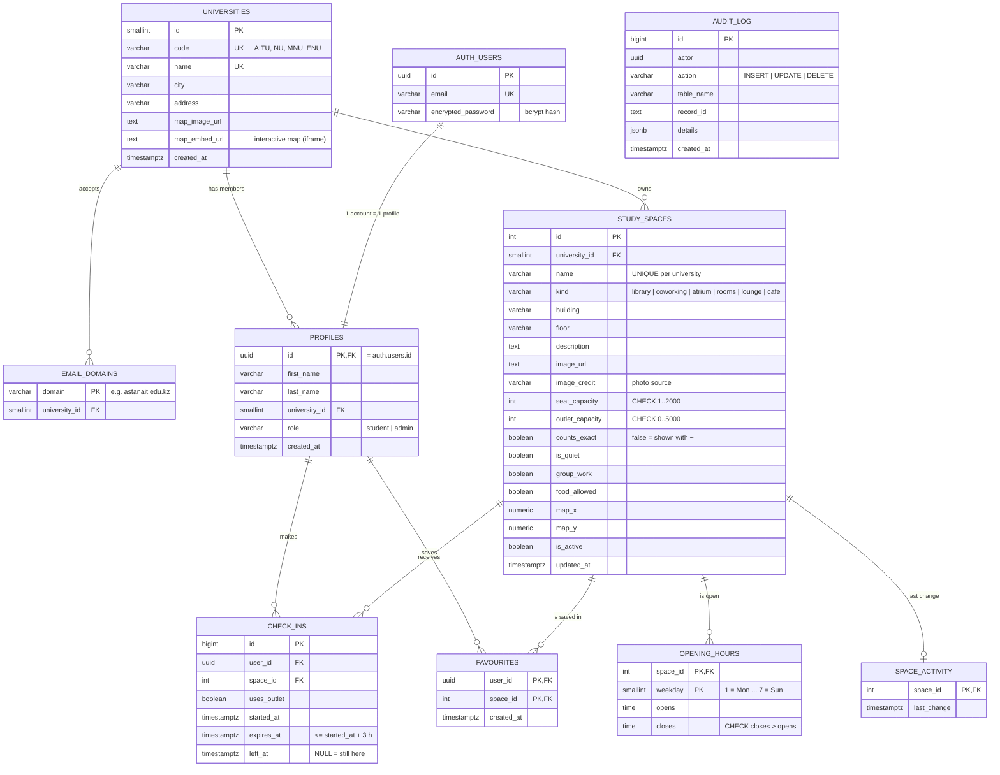

# OrynTap — Entity-Relationship Diagram

GitHub renders this diagram automatically. To export a picture for the report, paste the code block into <https://mermaid.live> and download PNG/SVG.

**Many-to-many:** `PROFILES ↔ STUDY_SPACES` (a student saves many places, and many students save the same place) is resolved by the linking table **FAVOURITES**, which has a composite primary key `(user_id, space_id)`. `CHECK_INS` also links the two tables, but it is an entity with its own id and timestamps.

## Normalisation example (for Part A2)

**Before (unnormalised check-in sheet, like a Google Form export):**

| check_in | student_email | student_name | university | space | space_seats | opens_mon | closes_mon | … | started | ended |
|---|---|---|---|---|---|---|---|---|---|---|
| 1 | 240512@astanait.edu.kz | John Doe | Astana IT University | Library | 250 | 08:00 | 22:00 | … | 14:20 | 16:20 |

* **1NF:** the repeating `opens_mon … closes_sun` columns move to their own table, **OPENING_HOURS (space_id, weekday, opens, closes)**. Every value is now atomic. This removes an **insertion anomaly**: before, you could not record hours for a new weekday without adding columns.
* **2NF:** facts about the student and about the space do not depend on the check-in key, so they move out to **PROFILES** and **STUDY_SPACES**. This removes an **update anomaly**: changing the Library's seat count used to mean editing hundreds of rows.
* **3NF:** `university` depended on the e-mail domain, not directly on the student. That is a transitive dependency, so it moves to **UNIVERSITIES** and **EMAIL_DOMAINS**. This removes a **deletion anomaly**: deleting the last AITU student no longer deletes what we know about AITU.
